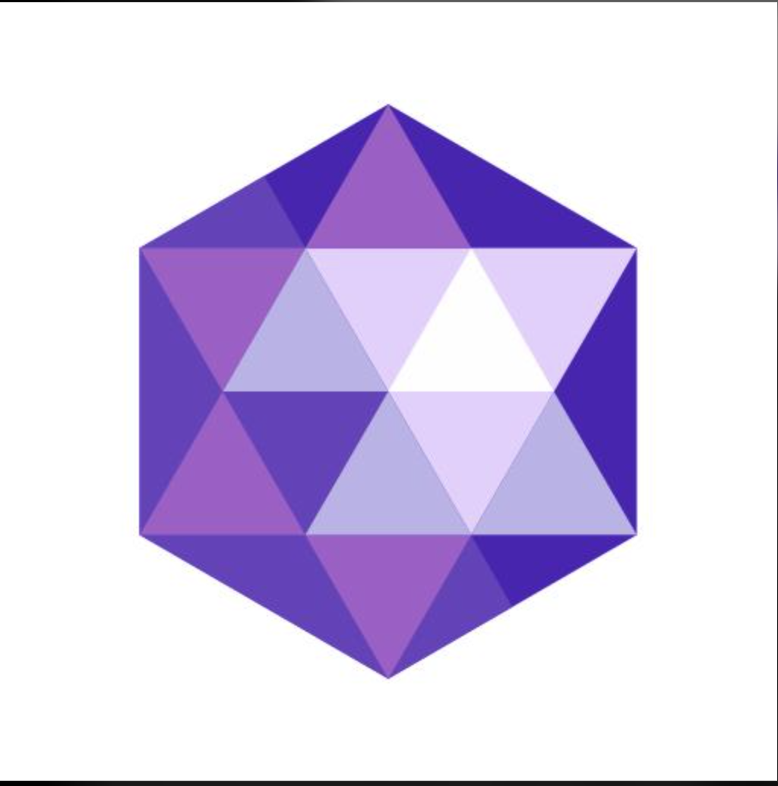

# Segundo Examen Parcial - Programación de Videojuegos

Repositorio correspondiente al segundo examen parcial de la materia de **Programación de Videojuegos** (UVM). El proyecto consta de dos ejercicios prácticos desarrollados en C++ utilizando OpenGL, GLFW, GLAD y GLM.

---

## Estructura del Proyecto

```text
prog-vid-2do-uvm/
├── ejercicio_1/
│   ├── casa.png
│   └── main.cpp
├── ejercicio_2/
│   ├── gema.png
│   └── mian.cpp
├── libs/
│   ├── glad/
│   ├── glfw/
│   └── glm/
├── .gitignore
└── README.md
```

---

## Ejercicio 1: Dibujo de Primitivas (Casa en OpenGL)

En este ejercicio se implementa la definición y renderizado de primitivas geométricas utilizando vértices, VAO y VBO en OpenGL para construir la figura de una casa.

### Objetivo
- Configurar la estructura de datos para los vértices requeridos.
- Utilizar shaders básicos (Vertex Shader y Fragment Shader) con paso de color uniforme.
- Renderizar la figura de la casa usando primitivas de OpenGL (`GL_TRIANGLES`).

### Resultado esperado / Referencia


---

## Ejercicio 2: Geometría y Transformaciones 2D (Gema en OpenGL)

En este ejercicio se modela una gema mediante triángulos y se aplican transformaciones geométricas sobre el objeto en el espacio 2D.

### Objetivo
- Generar la geometría base de la gema compuesta por 6 triángulos (18 vértices).
- Enviar una matriz de transformación (`uTransform`) al Vertex Shader utilizando GLM.
- Aplicar en la matriz de transformación:
  1. **Traslación**: Desplazar `0.4` unidades hacia la derecha (`glm::translate`).
  2. **Escalamiento**: Reducir el tamaño al `70%` (`glm::scale`).
  3. **Rotación**: Girar `45` grados sobre el eje Z (`glm::rotate`).
- Renderizar la gema con color morado mediante uniforms.

### Resultado esperado / Referencia


---

## Dependencias y Librerías

El proyecto incluye en la carpeta `libs/`:
- **[GLFW](https://www.glfw.org/)**: Manejo de ventanas, contextos de OpenGL y eventos de entrada.
- **[GLAD](https://glad.dav1d.de/)**: Cargador de funciones de OpenGL (versión 3.3 Core Profile).
- **[GLM](https://github.com/g-truc/glm)**: Librería de matemáticas para gráficos (vectores, matrices y transformaciones).

---

## Requisitos de Ejecución
- Compilador de C++ con soporte para C++17 o superior.
- Controladores compatibles con OpenGL 3.3+.
- Dependencias del sistema configuradas según el entorno de compilación (Visual Studio / CMake / Makefile / etc.).
